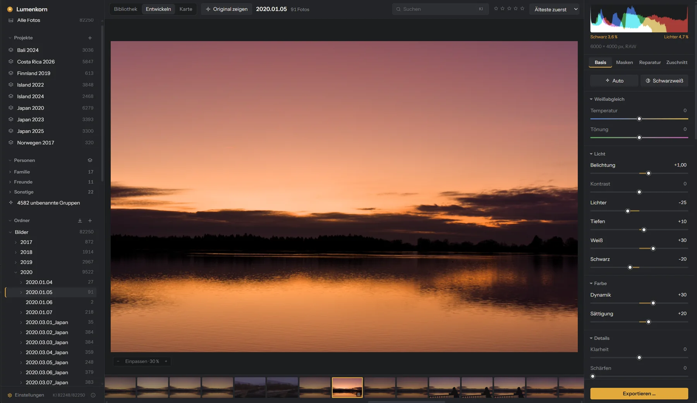
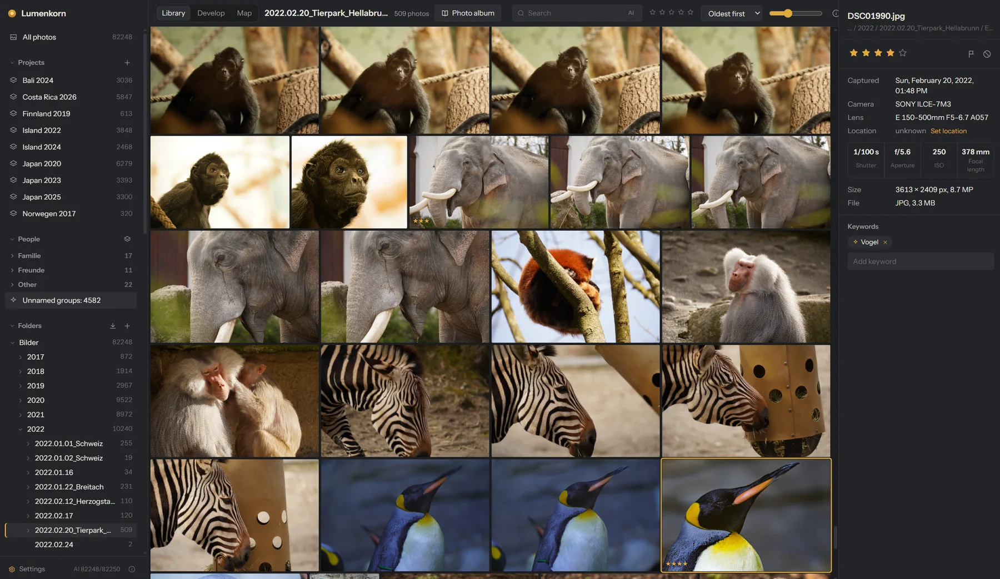
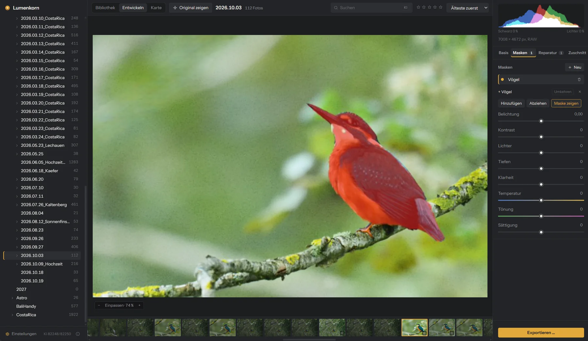
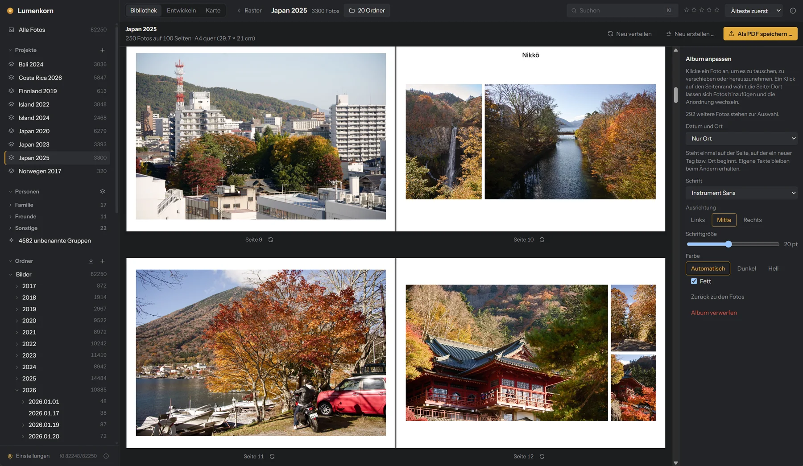
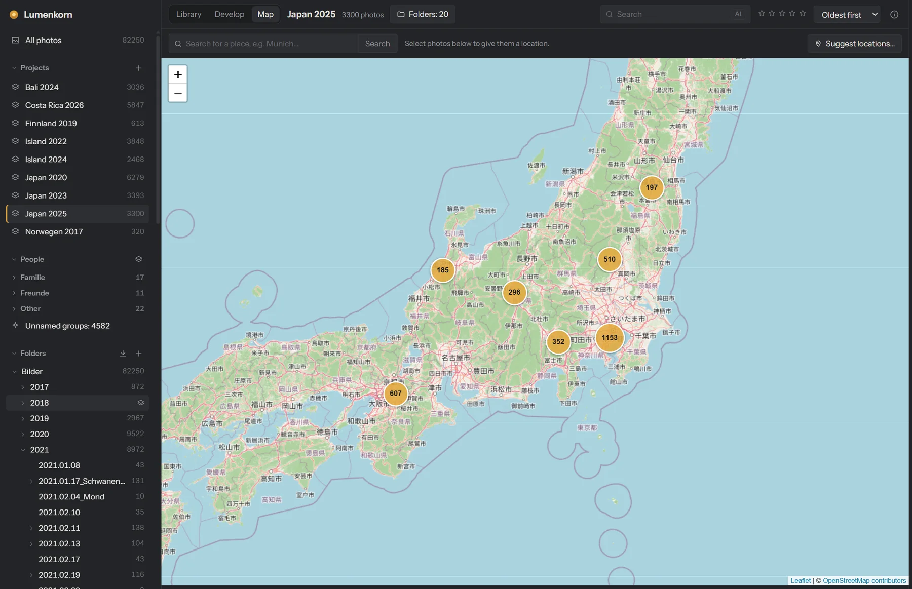

<div align="center">


# Lumenkorn

**Photo library and RAW developer that runs entirely on your own computer.**

[](https://github.com/DrayPrescot/lumenkorn/actions/workflows/ci.yml)
[](#license)


[Website](https://lumenkorn.com) · [Features](#features) · [Getting started](#getting-started) · [How it works](#how-it-works) · [Tech stack](#tech-stack) · [Open-source credits](#open-source-projects-used-by-lumenkorn) · [Deutsch](docs/README.de.md)



</div>

Lumenkorn is meant as a replacement for Lightroom Classic for people who want to keep their
photos and their edits on their own disk. You point it at your photo folders, it builds a
catalog, and you rate, sort, develop and export from there. The originals are never touched.

There is no account, no cloud and no subscription. The AI features (keywords, search by image
content, masks, noise reduction, object removal, face recognition) use open models that are
downloaded once and then run offline on your CPU or GPU. Only the map view needs the internet
(see [Map](#map)). If you want to share photos, Lumenkorn can upload a project's exports to your
own Nextcloud and create a share link, but only once you connect it yourself.

Lumenkorn has reached version 1.0. It is mainly used on Windows and is also built and tested
on Linux. The interface is in German and English and follows
the system language; **Settings → General** (bottom left of the sidebar) switches it.

**Built with AI:** A large part of Lumenkorn's code was written with an AI assistant. A person
decides what the program should do and whether a change is good enough, and every release is
tried on real photos before it goes out. Bugs can still slip through, so back up your photos and
the catalog before you let Lumenkorn loose on your whole collection.

## Features

### Library



- Folders are read in place. Nothing is copied or moved, unless you import from a card.
- Import from a memory card (`Ctrl+Shift+I` or the arrow next to “Folders”): pick photos by day
  or one by one in a preview grid, and Lumenkorn copies them to `Target\YYYY\YYYY.MM.DD[_Occasion]`
  as `YYYYMMDD_HHMMSS_Number` (capture time from EXIF, number from the camera's file name, so
  `DSC07869.ARW` becomes `…_7869.ARW`). RAW and JPEG pairs and `.xmp` files keep the same name.
  Photos already in the library are recognized. Every copy is checked byte for byte; only then
  can the originals be deleted from the card, if you ask for it.
- If a camera clock was off, for example still on home time during a trip, “Correct…” next to
  “Time” in the import dialog shifts the capture time per camera before copying. Folders, file
  names and the time stamps inside the copies (EXIF, XMP) get the corrected time; the files on
  the card are not touched. “Estimate” works out the difference from photos with a location
  already in the library, such as those from your phone.
- A file watcher picks up new, changed, renamed and moved files. Moved files are recognized by
  a content hash, so ratings, keywords and edits stay with the photo.
- Projects collect any number of folders, also across drives.
- Subfolders can be left out of the library per folder (right-click → "Unterordner einbeziehen");
  whether subfolders are included by default is set under Settings → Folders. Ratings and edits of
  excluded photos are kept and return when the folder is included again.
- Ratings (`0`–`5`), pick and reject flags (`P` / `X`), keywords, and a search over file name,
  folder, camera, lens, keywords, people and place names.
- **Filter** in the toolbar shows only edited or only unedited photos, and filters by format (ARW,
  CR3, JPEG, PNG …, or all RAW files at once), in the library and in Develop.
- **Statistics** shows the photos of the current view by camera, lens, focal length, aperture,
  shutter speed, ISO, month or year, time of day, keyword, person, country, file type and rating.
  Clicking an entry filters by it.
- **Metadata** (info panel → "Bearbeiten"): title, description, author, copyright, capture time
  (set, or shift for many photos), camera, lens, focal length, aperture, exposure time and ISO.
  Stored in the catalog and in an XMP sidecar (`photo.xmp`, or the existing `photo.ext.xmp`);
  sidecars from other programs are updated, not replaced, and the photo file stays untouched.
- **Nextcloud:** right-click a project → "Zu Nextcloud hochladen …" uploads its exported photos,
  or all of its photos as originals (rejected ones left out), to a folder in your Nextcloud and
  shares it as a link (optionally with password and expiry date).
  Uploading again only sends new and changed files and keeps the link. Connect under
  Settings → Nextcloud: you log in in the browser and Lumenkorn gets its own app password, kept in
  the system's credential store (Windows Credential Manager, on Linux the keyring via Secret
  Service) and revocable in Nextcloud at any time.
- **Batch rename** (`F2`): a pattern such as `{yyyy}{mm}{dd}_{hh}{min}{ss}_{n}` with date, time,
  number, camera, lens, folder and the old name. The preview lists every new name and conflicts;
  nothing is overwritten, XMP sidecars follow, RAW+JPEG pairs keep one name.
- Culling: `Shift+X` rejects and moves on. Rejected photos can be sent to the system trash in
  one step, together with their sidecar files and Lumenkorn's own data for them.
- **Culling assistant** (right-click a folder or project → "Aussortieren …") suggests what to reject: the weaker
  shots of a burst (the sharpest 3 to 5 stay, depending on its size), blurry photos, closed eyes,
  badly exposed photos and photos taken by accident. Sharpness is compared within a burst, so a
  portrait with a soft background is not called blurry; on its own a photo is only flagged when
  it is clearly out of focus. Eyes are checked with Face Mesh (needs face recognition and the AI
  masks for people), accidental shots with CLIP. You review the suggestions and borderline cases
  and switch between cautious, normal and strict; only what you tick is flagged as rejected.
  Photos with stars, a pick flag or edits are never suggested. The assistant learns from your
  decisions and from rejections you take back later, per reason and only once there are enough
  of them (`aussortieren.json` in the data folder; reset under Settings → AI).
- Compare up to 12 photos side by side with linked zoom, with a filmstrip below to swap photos
  in and out. Any photo can be viewed at 100 % from the full-resolution file.
- Supported formats: JPEG, PNG, TIFF (8, 16 and 32 bit), WebP, OpenEXR and RAW files from Canon,
  Nikon, Sony, Fujifilm, Panasonic, Olympus/OM System, Pentax, DNG and others supported by rawler.

### Develop (non-destructive)



- White balance (in Kelvin for RAW files, with **Automatic**), exposure, contrast, highlights, shadows,
  whites, blacks, clarity, dehaze,
  vibrance, saturation and sharpening. **Auto** (`Ctrl+U`) sets the tone sliders for a
  balanced result and learns your style from your edits (see below). **Black & White** (`V`)
  converts the photo; the HSL luminance sliders
  then act as the gray mix and color grading tones it.
  Highlights and shadows work on the bright and dark half of the image, whites and blacks
  only on the ends of the scale.
- HSL for eight color ranges, with an eyedropper that adjusts the color you click on.
- Color grading with wheels for shadows, midtones, highlights and the whole image, plus
  blending and balance, as in Lightroom.
- Tone curve below color grading, like darktable's RGB curve: one curve for RGB and one each for
  red, green and blue, with the histogram of the channel behind it. Click to add a point (up to
  16), drag to move it, double-click to remove it. The points are joined by a monotone spline, so
  the curve never overshoots between them. “Preserve colors” (on by default) applies the RGB
  curve to brightness so hue and saturation stay; turned off it works on each channel, as in
  Lightroom, and more contrast also means stronger colors.
- Lens correction for RAW files (on by default): distortion, color fringes and vignetting,
  from the correction data the camera writes into the file (Sony ARW, Panasonic RW2 for
  distortion, DNG) or from a [Lensfun](https://lensfun.github.io/) profile for about 1,500
  lenses, including the built-in lenses of compact and bridge cameras.
- Crop, rotate, flip, and straighten with automatic horizon detection. Perspective correction
  (vertical and horizontal) for converging lines, by slider or with guide lines: draw lines along
  edges that should be vertical or horizontal, and Lumenkorn sets straighten and perspective so
  they are. `Enter` applies the crop.
- In Develop, `Enter` releases the focus from a slider, so the arrow keys move through the
  filmstrip again.
- Local adjustments: linear and radial gradients, brush, color range, and AI masks for
  subject, sky, people (whole or parts such as hair, eyes, lips or skin), animals (birds,
  mammals, reptiles) and any object you click on. Shapes can be added to or subtracted from each
  other ("sky minus church tower").
- AI noise reduction and AI repair (remove dust, power lines, people, signs).
- History with undo/redo, snapshots, copy and paste of settings to many photos, and a
  "reset to original" button that asks before discarding everything.
- Export to JPEG, 16-bit TIFF, PNG or DNG, several formats at once if you like, by default into
  an `Export` folder next to each original (the subfolder can be changed in Settings → Folders,
  e.g. `Export/JPEG` or `../Exports`, or to the original's own folder). DNG is slightly lossy (linear, JPEG-compressed, as in
  Lightroom) and holds either the edited photo or the original image data without edits. If a
  file already exists, Lumenkorn asks whether to overwrite it, export as well (`name-2`) or skip
  it. Originals in the library are never overwritten. Every export carries the metadata
  (EXIF and XMP: camera and exposure data, capture time, title, description, author, copyright,
  your own keywords and the rating; edited values included). AI keywords and the location are left
  out.

### Auto in your style
Auto learns from your edits how you differ from its suggestions and adapts step by step,
separately for each camera and for RAW/JPEG:

1. For every edited photo Lumenkorn works out in the background what Auto would have suggested
   (with your other settings such as crop and colour) and keeps the difference to your result,
   together with a few brightness figures of the photo.
2. From about 10–20 edits per camera: a fixed adjustment per camera, e.g. “blacks −12”.
3. From about 50: depending on the photo's brightness, e.g. “dark photos a bit brighter”.
4. From about 300: from photos with similar subjects (using the CLIP image features).

A slider is only adjusted when that demonstrably gets closer to your results: each edited photo is
predicted without itself, and only sliders that beat the plain Auto are used. Newer edits count
more, so a changing style is followed. Everything stays on your computer (`stil.json` in the data
folder). Under **Settings → Develop** you see what has been learned and can switch learning off or reset
it.

### Merge
Select photos, right-click and choose **Zusammenfügen** (merge):

- **HDR** from exposure brackets (`Ctrl+H`), handheld, up to ±6 EV, with optional deghosting.
- **Panorama** (`Ctrl+M`) in any shot order and with several rows; cylindrical, spherical or
  perspective projection.
- **Focus stacking** (`Ctrl+Shift+F`), which also corrects focus breathing.

The result is a linear 16-bit OpenEXR file next to the source photos. It goes into the catalog
right away and is developed like a RAW file, so highlights above 1.0 can still be recovered.

<br clear="right">

### Photo album



**Fotoalbum** above a project or folder makes a photo book from it. Pick a theme (vacation,
travel, wedding, birthday, family, baby, nature, party, sports, animals, or describe your own),
a page size (30×30, 20×20, A4 portrait or landscape, 28×21, A3 or your own in mm), the number of
photos and pages, with or without margins.

- Lumenkorn measures sharpness (at the sharpest spot, so portraits with a soft background are
  fine) and exposure on the previews, and adds your stars and picks. With the AI set up, CLIP
  scores how well a photo fits the theme and pushes screenshots and photos of documents down;
  for people themes, faces count. Without the AI the theme is left out.
- By default only edited photos and JPEGs are used; unedited RAW files, which only show the
  flat camera image, are left out. In the dialog, **Photos** can be set to edited only, edited
  and JPEGs, or all.
- Bursts and near-identical shots count as one, even with other photos in between, unless
  different people are in them. Photos with 4 or 5 stars are always included, even if that makes
  the album larger than asked for. Photos are spread over the days and outings of the project,
  and within one, varied shots win over similar ones.
- Pages are filled in time order and try not to mix outings. Each page gets the layout that
  crops the photos least; the best photos sometimes get a page of their own.
- Then edit it: click a photo to swap it for another one (shots from the same burst come first),
  remove it or move it to the next or previous page; drag it to move the crop. Click a page to
  add photos, try a different layout, or insert and delete pages. A red badge marks photos whose
  resolution is too low for their size in print.
- **Texts:** date and place are written once on the page where a new day or place begins (date
  and place, date only, place only, or none). Add your own texts above or below the photos (the
  photos move together) or anywhere on the page by dragging, with size, alignment, colour and
  bold, in Instrument Sans, Lora or any font installed on the system; the style of the captions (and the default for new texts) is
  chosen when creating the album and can be changed for all of them later. Texts are drawn the same way for the preview and the print.
- **Map:** a map page as first or last page shows the country outlines, highlights the countries
  you visited and puts a pin on every place; places close together share one pin, named after
  the town or, for a whole island, the region. The names can be changed or hidden in the side
  panel. Larger cities, major mountains with their height, rivers and lakes are added where there
  is room (each can be switched off). It needs no internet.
- **Save as PDF** writes a print-ready PDF (300 dpi, 3 mm bleed on each side, trim box set) and a
  folder with every page as a JPG, which most photo book printers accept. The album is kept and
  can be opened and changed again later.

### People
Faces are found in the background, grouped by similarity, and suggested for a name once you
have named a few. Suggestions can be confirmed or rejected one by one or many at once. Named
people can be sorted into your own collapsible groups, such as family and friends; the rest are
listed under *Sonstige*, and faces not named yet under *Unbenannt*, so the overview stays short.

### Map



The **Map** tab (`M`, next to Library and Develop) shows the photos of the current view (folder,
project, person, search, filters) as clustered markers on an OpenStreetMap world map. Click a
marker or cluster to select those photos in the filmstrip below (`Ctrl` adds to the selection);
clusters zoom in.

- GPS data from the camera or phone (EXIF) is read when photos are scanned. For photos already
  in the catalog it is filled in once in the background.
- To set a location, select photos in the filmstrip and then search for a place above the map
  (e.g. “München”), press `Enter`, pick a result and click “Use for N photos”; or drag the photos
  onto the map; or right-click the map and choose “Move N selected photos here”. “Remove
  location” clears it. Photos with a location show a small pin in the filmstrip.
- Every location gets a name such as “München, Bayern, Deutschland”, always in Latin script
  (for Japan, say, the English or romanised name instead of kanji). The library search covers
  it, so “Ubud” finds the photos taken there. The info panel shows the name (or the coordinates
  until the name is known) with a link to the map.
- Locations you set are stored only in the catalog. The files are not changed, and a rescan does
  not overwrite a location set by hand.
- **Suggest locations…** (button above the map) gives photos without a location the location
  of a photo with one (say, from your phone) taken a few minutes before or after. It works on the
  photos of the view, or on the selected ones, and only runs when you click it; nothing is saved
  until you tick the suggestions and confirm. If the camera clock is off, Lumenkorn estimates the
  difference per camera from the times of both, or you enter it yourself.
- The map and the place names need the internet; see [Your data](#your-data).

## Getting started

### Download
The current state of `main` is always available as a Windows installer (German and English
MSI) under the [nightly](https://github.com/DrayPrescot/lumenkorn/releases/tag/nightly)
pre-release. It is rebuilt after every push that passes CI, and a new version installs over
the old one. Tagged versions on the [Releases](https://github.com/DrayPrescot/lumenkorn/releases)
page also include Linux packages (`.deb`, `.rpm`, `.AppImage`).

### Updates
Shortly after starting, Lumenkorn checks once whether a newer version has been released on
GitHub. If there is one, it shows what changed and asks; **Install now** downloads it, checks
its signature, installs it and restarts, **Later** asks again at the next start. Catalog and
edits are kept. Updates follow the versioned releases (not *nightly*); the AppImage updates
itself on Linux, `.deb` and `.rpm` are updated by the package manager.

The installers are not code-signed yet. Windows SmartScreen will ask once
("More info" → "Run anyway").

### AI agents (MCP)
Lumenkorn has a built-in [Model Context Protocol](https://modelcontextprotocol.io) server, so
AI agents such as Claude or ChatGPT/Codex can operate it. It is off by default; switch it on
under **Settings → AI agents (MCP)**, where the dialog also shows the exact settings to copy.

- **stdio** (Claude Desktop, OpenAI Codex and most other agents): command `lumenkorn.exe`
  (full path) with the argument `--mcp`. This small bridge starts Lumenkorn if needed and passes
  everything to the running app.
- **HTTP** (Claude Code and other agents that support it): `http://127.0.0.1:47823/mcp` with
  the header `Authorization: Bearer <key>`. The key is stored in `mcp.json` in the data folder;
  only this computer can connect, and requests from websites are refused.

Tools: `list_library`, `search_photos` (text, content search, folder, project, person,
rating, flag, file type), `get_photo`, `view_photo` (the photo as an image with its edits), `rate_photos`,
`flag_photos`, `tag_photos`, `get_develop_settings`, `set_develop_settings` (merge any develop
values), `auto_tone`, `reset_photos`, `apply_preset`, `copy_settings`, `add_mask` (AI mask such
as sky, person:eyes or animal:bird with local adjustments), `export_photos` and `show_photo`.
None of them deletes photos or removes folders. Changes appear in the app right away; for the
photo open in Develop they can be undone with `Ctrl+Z`.

### First steps
1. Click **+** next to *Ordner* and choose a folder with photos.
2. Rate with `0`–`5`, flag with `P` / `X`, and press `D` to develop the selected photo.
3. Optional: **Settings → AI** (bottom left) downloads the AI models, one by one or with
   **Download all AI components**. Everything else works without them.

### Keyboard shortcuts

These are the defaults. Under **Settings → Keyboard shortcuts** every command can get other or
additional keys (a key already in use is reported); arrow keys, Enter, Space and Escape stay fixed.

| Key | Action |
|---|---|
| Arrow keys | Move between photos |
| `Enter` / `E` | Show large (several selected: compare) |
| `D` / `G` or `Esc` | Develop / back to the grid |
| `M` | Map |
| `0`–`5` | Rating |
| `P` / `X` / `U` | Pick / reject / clear flag |
| `Shift+X` | Reject and go to the next photo |
| `Ctrl+Del` | Delete rejected photos (asks first) |
| `F2` | Rename selected photos |
| `C` | Compare selected photos |
| `Z`, mouse wheel | Zoom (fit ↔ 100 %) |
| `\` | Before / after |
| `R` | Crop |
| `[` / `]` | Rotate left / right |
| `O` | Show the selected mask in red |
| `Ctrl+U` | Auto tone (Develop) |
| `V` | Black & white on/off (Develop) |
| `Ctrl+Z` / `Ctrl+Shift+Z` | Undo / redo |
| `Ctrl+Shift+C` / `Ctrl+Shift+V` | Copy / paste settings |
| `Ctrl+Shift+E` | Export selection |
| `Ctrl+Shift+I` | Import photos from a memory card |
| `Ctrl+H` / `Ctrl+M` / `Ctrl+Shift+F` | HDR / panorama / focus stack |
| `F11` | Fullscreen |

The [German documentation](docs/README.de.md) describes every feature in more detail.

## How it works

Lumenkorn is a desktop app made of two halves. The window shows a web interface written in
Svelte. Everything that touches files, pixels or models happens in Rust. The two talk through
Tauri: the interface calls Rust commands and gets JSON back, and images are fetched through a
custom `lw://` URL scheme, so pixel data never goes through JSON and the webview can cache it.

```
 Svelte UI (src/)                      Tauri shell (src-tauri/)
 ┌──────────────────────┐   commands   ┌───────────────────────────────────────────┐
 │ grid, develop, masks │ ───────────▶ │ commands, background worker, lw:// images │
 │ people, compare, ... │ ◀─────────── │ progress events, crash guard, log file    │
 └──────────────────────┘ JSON, events └────┬──────────────┬──────────────┬────────┘
                                            │              │              │
                                  lumenkorn-core   lumenkorn-develop   lumenkorn-ai
                                  catalog, scan,   RAW decoding,       ONNX Runtime,
                                  thumbnails,      pipeline (CPU+GPU), models, masks,
                                  people           masks, merge, export denoise, faces
```

The three crates do not know about Tauri. They can be used and tested without a window.

### Catalog and folders
The catalog is a single SQLite database in the app data folder. It stores source folders,
photos, projects, keywords, faces and edits. A scan walks the folders, reads EXIF data and
hashes each file with BLAKE3. When a file disappears and a file with the same hash shows up
elsewhere, it is treated as moved and keeps its data. After the first scan a file watcher
reports changes; Lumenkorn collects them for 1.5 seconds and only looks at the reported
paths, which matters on network drives with tens of thousands of files.

Search uses an SQLite FTS5 index with trigrams, so partial words match ("sonnen" finds
"Sonnenuntergang") and accents do not matter.

Thumbnails (512 px) and previews (2048 px) are JPEGs in the system cache folder. For unedited
RAW files Lumenkorn uses the JPEG the camera embedded, which is much faster than developing.
Once a photo is edited, its thumbnail is rendered by the develop pipeline. Previews are limited
to 5 GB by default (Settings → General); beyond that the ones not viewed for the longest time are
deleted and rendered again when needed.

### The develop pipeline
An edit is a small JSON document with all slider values, masks and geometry. Nothing else is
saved, so edits take no extra disk space and can always be changed or undone.

To show a photo, Lumenkorn decodes it once into a linear floating-point image:

1. RAW files are read with [rawler](https://github.com/dnglab/dnglab). From there on
   Lumenkorn follows the default scene-referred workflow of
   [darktable](https://github.com/darktable-org/darktable) 5.0, translated from darktable's C
   code to Rust: sensor white and black levels from the
   [rawspeed](https://github.com/darktable-org/rawspeed) camera database, white balance as
   shot by the camera, highlight reconstruction ("inpaint opposed"), RCD demosaicing for Bayer
   sensors (Markesteijn with one pass for Fujifilm X-Trans, through rawler), exposure of
   +0.7 EV minus the camera's exposure compensation, the camera matrix to linear Rec.2020, and
   color calibration with CAT16 from the camera's illuminant. Lumenkorn also applies capture
   sharpening at sensor resolution, adapted to the measured noise, because every RAW is
   slightly soft out of the camera.
2. JPEG, PNG, TIFF and WebP are converted to linear light. Very large images (panoramas,
   astro stacks) are averaged down while converting instead of being expanded to a full-size
   float copy first.

For the live preview this image is scaled to 2048 px and kept in memory. Every slider change
runs the pipeline on that proxy, which takes a few milliseconds on a GPU. When you zoom in,
only the visible part is rendered again from full resolution. Export renders the whole photo
at full resolution.

The pipeline runs in a fixed order:

| Step | Works on |
|---|---|
| Lens correction (RAW only) | linear, before everything else |
| White balance, exposure | linear scene light |
| Sigmoid tone mapping (RAW only) | scene light → display |
| Dehaze | display-referred values |
| Whites/blacks, highlights/shadows, contrast, clarity | brightness |
| Vibrance, saturation, HSL, color grading | color (HSL in Oklch) |
| Tone curve | display-referred values (RGB or brightness, each channel) |
| Local adjustments (masks) | each layer blended in |
| Sharpening | brightness |
| Rotate, flip, straighten, crop | last |

Highlights, shadows and clarity work with blurred brightness maps whose radius is relative to
the image size, so the 2048-px preview looks like the 6000-px export. Dehaze estimates the haze
with a dark-channel method, but with a neutral haze color, so colors do not drift blue or
yellow. With default settings the pipeline leaves a JPEG unchanged.

### GPU
The same pipeline exists twice: in Rust for the CPU (parallel with Rayon) and as WGSL compute
shaders for the GPU through [wgpu](https://wgpu.rs). wgpu talks to the graphics driver
directly, through DirectX 12 or Vulkan on Windows and Vulkan on Linux, so nothing extra has
to be installed. A test renders every slider, mask type and geometry case on both and compares
the pixels; the largest allowed difference is far below one 8-bit step. If there is no
suitable GPU or the driver fails, Lumenkorn uses the CPU path.

### Masks
A mask layer has its own set of sliders and consists of one or more shapes. Gradients, brush
strokes and color ranges are stored as parameters. AI masks are stored as grayscale PNG files in
the data folder. Masks refer to the upright original image, so rotating or cropping later does
not move them off the subject. The shape of each mask is computed on the CPU and cached, because
it does not change while you drag a slider.

### AI features
The AI part uses [ONNX Runtime](https://onnxruntime.ai) through the
[ort](https://github.com/pykeio/ort) crate. ONNX Runtime is not built into the app. It is loaded
at run time, so Lumenkorn starts and works without it, and the right build can be downloaded per
platform. For the GPU, Lumenkorn downloads the official WebGPU build of ONNX Runtime, which runs
on AMD, NVIDIA and Intel cards through DirectX 12, Vulkan or Metal, without CUDA or ROCm.
GPU sessions take turns, because the WebGPU backend does not allow two models to compute at
the same time.

| Feature | Model | What Lumenkorn does with it |
|---|---|---|
| Keywords, search by content | CLIP ViT-B/32 | Compares each photo with a vocabulary of German and English terms in five groups (place, subject, light, weather, style), and decides whether an animal is in it. Search turns your text into the same kind of vector. |
| Animal species (optional) | BioCLIP 2 (ViT-L/14, image encoder) | Names about 10,000 animals from class to species (Bird → Tits → Blue tit) on photos where CLIP sees an animal, and goes only as deep as it is sure. The list holds the species most observed on [iNaturalist](https://www.inaturalist.org) in Europe, birds worldwide, all primates, and the mammals, birds and reptiles of Kenya, Tanzania and South Africa, with German and English names from [Wikidata](https://www.wikidata.org) (CC0). Species that are often observed in their region get a small head start, so a grey heron does not end up as a North American great blue heron. The text side is computed in advance from taxonomic names (`tools/bioclip`) and downloaded with the model. Without it, CLIP names about 300 animals, less precisely. |
| Subject mask | IS-Net (DIS) | Predicts the main subject. |
| Object mask | Segment Anything ViT-B | Turns your clicks into a mask; the image embedding is computed once per photo. |
| Sky mask | skyseg (U²-Net) | Predicts the sky. Uncertain edges, such as tree tops, are then decided by comparing each pixel with the colors of nearby sure sky and sure foreground. Without the model a color-based rule set is used. |
| Person and animal masks | OWLv2, MediaPipe Selfie Multiclass and Face Mesh, Segment Anything | OWLv2 finds people, faces and animals from text queries. Whole people and animals are cut out by Segment Anything from the found box; hair, skin and clothes come from Selfie Multiclass on a crop around each person or face; eyes, iris, brows and lips are outlined from the 478 Face Mesh points. |
| Noise reduction | DRUNet | Lumenkorn downloads the original PyTorch weights and converts them to ONNX on your machine. The noise level is estimated per brightness and on two scales; color noise gets an extra pass at half resolution. |
| Object removal | LaMa | Each area is cut out with some surroundings, filled and blended back at full resolution. |
| Faces | YuNet, SFace | YuNet finds faces (also small ones in group photos, by searching in tiles), SFace turns each aligned face into a vector. Similar vectors form a group. |

Results that are expensive to compute (denoised image, repair patches, AI masks) are stored in
the data folder and used by the pipeline like any other input. Models are unloaded after a
few minutes without use.

**Settings → AI → Use AI features** switches all of this off. The AI runtime and models are then
never loaded and nothing is analyzed in the background; results computed earlier stay and still
apply. If AI is on and a GPU is found but the GPU runtime is missing (or AI is set to “CPU
only”), Lumenkorn asks after the start whether to download and turn it on; “No, don’t ask again”
is remembered.

On computers with up to 8 GB of RAM, the **memory saver** (Settings → General) turns on by itself.
It keeps fewer images and masks in memory, unloads models and full-size images after one minute,
and develops large images one at a time. It can also be switched on or off by hand.

### Merge
All three merge modes share an alignment step: Harris corners on a brightness-normalized
image, BRIEF descriptors, matching by Hamming distance, and a homography estimated with
RANSAC.

- **HDR** takes the middle exposure as reference, measures the real exposure ratios from the
  pixels, and merges to linear radiance with weights that favor well-exposed and less noisy
  values. Deghosting falls back to the reference where something moved.
- **Panorama** builds a graph of all overlapping pairs, estimates the focal length and the
  rotation of each shot, levels the horizon, projects and equalizes brightness. Each pixel then
  comes from one shot: the seam between two shots runs where they differ least, so objects close
  to the camera, which shift between shots, are not doubled. Only a narrow strip along the
  seams is blended.
- **Focus stacking** splits each frame into a Laplacian pyramid and keeps, per level and pixel,
  the sharpest detail.

### Your data
- Catalog, edits, AI models and AI results live in the app data folder:
  - Windows: `%APPDATA%\io.github.drayprescot.lumenkorn\`
  - Linux: `~/.local/share/io.github.drayprescot.lumenkorn/`
- Thumbnails are in the system cache folder.
- Lumenkorn writes to your photo folders only when you ask it to: deleting rejected photos,
  saving merge results, or exporting.
- Network access: downloading the AI runtime and models when you click the button for it
  (files with a published checksum are verified with SHA-256), and the map view. Map tiles come
  from `tile.openstreetmap.org` and place search and place names from
  `nominatim.openstreetmap.org`. The requests go through the app with an identifying user agent,
  at most one Nominatim request per second, and tiles are cached on disk for 7 days. The
  coordinates of your photos are sent to Nominatim to look up place names, rounded to about
  100 m and bundled: one request covers all photos inside the same town or village. Everything else
  stays local. **Settings → General → Map and place names** switches all of this off; then nothing
  is sent to OpenStreetMap (the map in the photo album still works, it is built in).
- Nextcloud: only after you connect under Settings → Nextcloud, and only to the server you
  enter. Uploads go there when you start them for a project; the app password is kept in the
  system's credential store (Windows Credential Manager; on Linux GNOME Keyring, KWallet or
  another Secret Service), not in the data folder.
- A log file (`lumenkorn.log`) in the data folder records errors and what the AI did.
  Before risky native steps (loading a GPU runtime, opening a model) Lumenkorn leaves a marker
  file. If the app crashes there, the next start switches the cause off and explains why.

## Tech stack

| Area | Used |
|---|---|
| Language (backend) | Rust 1.95, edition 2024 |
| App shell | Tauri 2 (WebView2 on Windows, WebKitGTK on Linux) |
| Interface | Svelte 5 with runes, TypeScript, Vite |
| Database | SQLite (bundled through rusqlite), FTS5 full-text search |
| RAW decoding and development | rawler (from dnglab); RCD, inpaint opposed, color calibration and sigmoid translated from darktable; sensor levels from rawspeed |
| Image files | image-rs, jpeg-encoder, exrs, kamadak-exif |
| GPU image processing | wgpu with WGSL compute shaders |
| CPU parallelism | Rayon |
| AI inference | ONNX Runtime via ort, CPU or WebGPU |
| Downloads | ureq with the operating system's certificate store |
| CI | GitHub Actions, Mesa lavapipe for GPU tests without a GPU, Dependabot |
| Installers | Tauri bundler: MSI and NSIS on Windows, deb, rpm and AppImage on Linux |

## Building from source

**Requirements**
- Rust 1.95 (pinned in `rust-toolchain.toml`; rustup installs it automatically).
- Node.js 20 or newer.
- The [Tauri prerequisites](https://v2.tauri.app/start/prerequisites/) for your platform:
  - **Windows:** Microsoft C++ Build Tools and WebView2 (usually preinstalled on Windows 10 and 11).
  - **Debian/Ubuntu:**
    ```bash
    sudo apt install libwebkit2gtk-4.1-dev build-essential libxdo-dev libdbus-1-dev libssl-dev \
      libayatana-appindicator3-dev librsvg2-dev
    ```

**Commands**
```bash
npm install
npm run tauri dev          # run the app with hot reload
npm run tauri build        # build installers
npm run dev                # interface only, in the browser, with demo data

cargo test --workspace     # all tests
cargo run --release -p lumenkorn-develop --example bench    # CPU vs. GPU benchmark
```

`LUMENKORN_DATA_DIR=<folder>` makes the app use its own catalog and cache in that folder. Use it
when trying out a development build, so your real catalog is not upgraded to a schema that the
installed version cannot open yet.

GPU tests on machines without a GPU need Mesa's software Vulkan driver (lavapipe) and
`LUMENKORN_GPU_SOFTWARE=1`. Some tests use real model files or photos and only run when the
matching `LUMENKORN_TEST_*` variables are set; the
[German documentation](docs/README.de.md#entwickeln-am-code) lists them.

### Repository layout
```
lumenkorn/
├── crates/lumenkorn-core/      catalog, folder scanner, file watcher, thumbnails, people
├── crates/lumenkorn-develop/   RAW decoding, demosaicing, pipeline (CPU + gpu/ shaders),
│                               masks, repair patches, merge/, export
├── crates/lumenkorn-ai/        ONNX Runtime loading, CLIP, segmentation, DRUNet, LaMa,
│                               faces, model downloads, a small ONNX writer
├── src-tauri/                  Tauri commands, background worker, lw:// protocol, crash guard
├── src/                        Svelte interface, translations in src/lib/i18n/
├── scripts/, tools/            translation check, test model generator
└── docs/                       German documentation, screenshots
```

## Contributing
Issues and pull requests are welcome. Please run these before submitting:
```bash
cargo fmt --all
cargo clippy --workspace --all-targets -- -D warnings
cargo test --workspace
npm run check
npm run i18n               # every UI text has an English translation
```

Interface texts are written in German in the source and double as their keys:
`t("Ordner hinzufügen")` shows "Add folder" in English. The English texts are in
`src/lib/i18n/en/*.ts`. Backend messages use `tr!("deutsch", "english")`.

Dependabot checks Rust crates, npm packages and GitHub Actions every Monday. Small updates are
merged automatically after CI passes; breaking ones are labeled `manual-review`. CI also tests
every rawler update against real RAW files from several cameras. The Rust toolchain, the AI
models and ONNX Runtime are pinned on purpose and updated by hand.

A version tag such as `v0.2.0` builds the Windows and Linux installers and creates a draft
release. Its text is the version's section of the CHANGELOG. With the secret
`TAURI_SIGNING_PRIVATE_KEY` (minisign key from `npx tauri signer generate`; the public key is in
`tauri.conf.json`) the installers are signed for the updater and `latest.json` is attached; once
the draft is published, installed copies offer the update.

Without GitHub Actions, the VS Code task **Lumenkorn: Release bauen** (or
`node tools/release_local.mjs <path to lumenkorn-updater.key>`) builds the Windows installers,
signs them and writes `latest.json`; upload both MSI files and `latest.json` to a published
release tagged `v<version>`.

## Open-source projects used by Lumenkorn

Lumenkorn would not exist without the following projects. Thank you to everyone who works on them.
The same list is shown in the app: click ⓘ (**About Lumenkorn**) at the bottom left of the sidebar.

### Libraries built into the app

| Project | Used for | License |
|---|---|---|
| [Tauri](https://github.com/tauri-apps/tauri) with the [dialog, updater and single-instance plugins](https://github.com/tauri-apps/plugins-workspace) | app shell, window, file dialogs, updates | MIT or Apache-2.0 |
| [Svelte](https://github.com/sveltejs/svelte) | user interface | MIT |
| [rawler](https://github.com/dnglab/dnglab) (dnglab) | reading RAW files | LGPL-2.1 |
| [darktable](https://github.com/darktable-org/darktable) | RAW development: highlight reconstruction, demosaicing, color calibration, sigmoid (code translated to Rust) | GPL-3.0-or-later |
| [rawspeed](https://github.com/darktable-org/rawspeed) camera data (`cameras.xml`, reduced to a table by `tools/rawspeed_white.py`) | sensor white and black levels | LGPL-2.1-or-later |
| [wgpu](https://github.com/gfx-rs/wgpu) | GPU image processing | MIT or Apache-2.0 |
| [ort](https://github.com/pykeio/ort) | Rust bindings for ONNX Runtime | MIT or Apache-2.0 |
| [ONNX Runtime](https://github.com/microsoft/onnxruntime) | running the AI models (downloaded on demand) | MIT |
| [Dawn](https://dawn.googlesource.com/dawn) and the [DirectX Shader Compiler](https://github.com/microsoft/DirectXShaderCompiler) | part of the WebGPU build of ONNX Runtime | BSD-3-Clause, NCSA (`dxil.dll`: Microsoft license) |
| [SQLite](https://sqlite.org) via [rusqlite](https://github.com/rusqlite/rusqlite) | catalog and search index | public domain / MIT |
| [image](https://github.com/image-rs/image) | reading and writing JPEG, PNG, TIFF, WebP | MIT or Apache-2.0 |
| [jpeg-encoder](https://github.com/vstroebel/jpeg-encoder) | fast JPEG encoding | MIT or Apache-2.0, IJG |
| [exrs](https://github.com/johannesvollmer/exrs) | OpenEXR files for merge results | BSD-3-Clause |
| [kamadak-exif](https://github.com/kamadak/exif-rs) | EXIF metadata | BSD-2-Clause |
| [Rayon](https://github.com/rayon-rs/rayon) | parallel CPU processing | MIT or Apache-2.0 |
| [notify](https://github.com/notify-rs/notify) | file watching | CC0-1.0 |
| [walkdir](https://github.com/BurntSushi/walkdir) | folder scanning | MIT or Unlicense |
| [BLAKE3](https://github.com/BLAKE3-team/BLAKE3) | content hashes for moved files | CC0-1.0 or Apache-2.0 |
| [trash](https://github.com/Byron/trash-rs) | moving files to the system trash | MIT |
| [ureq](https://github.com/algesten/ureq) | model downloads, map, Nextcloud | MIT or Apache-2.0 |
| [quick-xml](https://github.com/tafia/quick-xml) | XMP sidecars, Nextcloud (WebDAV) | MIT |
| [keyring](https://github.com/open-source-cooperative/keyring-rs) | Nextcloud app password in the system credential store | MIT or Apache-2.0 |
| [fontdb](https://github.com/RazrFalcon/fontdb) | list of system fonts for the photo album | MIT |
| [tiny_http](https://github.com/tiny-http/tiny-http) | interface for AI agents (MCP) | MIT or Apache-2.0 |
| [serde](https://github.com/serde-rs/serde), [serde_json](https://github.com/serde-rs/json) | settings, edits, IPC | MIT or Apache-2.0 |
| [RustCrypto sha2](https://github.com/RustCrypto/hashes) | download checksums | MIT or Apache-2.0 |
| [flate2](https://github.com/rust-lang/flate2-rs), [tar](https://github.com/composefs/tar-rs), [zip](https://github.com/zip-rs/zip2) | unpacking runtime downloads | MIT or Apache-2.0 / MIT |
| [half](https://github.com/VoidStarKat/half-rs), [bytemuck](https://github.com/Lokathor/bytemuck), [pollster](https://github.com/zesterer/pollster) | 16-bit floats, GPU buffers | MIT or Apache-2.0 |
| [regex](https://github.com/rust-lang/regex), [log](https://github.com/rust-lang/log), [env_logger](https://github.com/rust-cli/env_logger), [thiserror](https://github.com/dtolnay/thiserror), [libloading](https://github.com/nagisa/rust_libloading), [dirs](https://github.com/dirs-dev/dirs-rs), [base64](https://github.com/marshallpierce/rust-base64) | text processing, logging, errors, loading DLLs, folders, encoding | MIT or Apache-2.0 / ISC |
| [Lensfun](https://github.com/lensfun/lensfun) database (bundled, converted to JSON by `tools/lensfun_db.py`) | lens profiles for lens correction | CC BY-SA 3.0 |
| [Instrument Sans](https://github.com/Instrument/instrument-sans) via [Fontsource](https://fontsource.org) | interface font, photo album | OFL-1.1 |
| [Lora](https://github.com/cyrealtype/Lora-Cyrillic) via [Fontsource](https://fontsource.org) | serif font for the photo album | OFL-1.1 |
| [Natural Earth](https://www.naturalearthdata.com) countries 1:50m, populated places, elevation points, rivers and lakes 1:10m (built into the app, made with `tools/build_countries.mjs` and `tools/build_mapdetails.mjs`) | map in the photo album | Public domain |
| [Leaflet](https://github.com/Leaflet/Leaflet) | map display | BSD-2-Clause |
| [Leaflet.markercluster](https://github.com/Leaflet/Leaflet.markercluster) | clustered markers on the map | MIT |

Online service: the map uses [OpenStreetMap](https://www.openstreetmap.org/copyright). Map data
© OpenStreetMap contributors (ODbL), standard tiles CC BY-SA 2.0, place search through Nominatim.
The attribution is shown on the map.

Not open source, but needed: on Windows the interface runs in Microsoft WebView2, which is part
of Windows, and the GPU build of ONNX Runtime needs the Microsoft Visual C++ Redistributable
(Lumenkorn tells you if it is missing). Neither is shipped with Lumenkorn.

### AI models (downloaded on demand, not shipped with the app)

| Model | Authors | Downloaded from | License |
|---|---|---|---|
| CLIP ViT-B/32 | OpenAI; ONNX conversion by [Xenova](https://huggingface.co/Xenova/clip-vit-base-patch32) | Hugging Face | MIT |
| IS-Net / DIS | [Xuebin Qin et al.](https://github.com/xuebinqin/DIS) | [rembg](https://github.com/danielgatis/rembg) releases | Apache-2.0 |
| Segment Anything (ViT-B, quantized) | [Meta AI](https://github.com/facebookresearch/segment-anything) | rembg releases | Apache-2.0 |
| skyseg (U²-Net) | [xiongzhu666](https://github.com/xiongzhu666/Sky-Segmentation-and-Post-processing), based on [U²-Net](https://github.com/xuebinqin/U-2-Net) | [Hugging Face](https://huggingface.co/JianyuanWang/skyseg) | MIT |
| OWLv2 (base, patch16) | [Google Research](https://github.com/google-research/scenic/tree/main/scenic/projects/owl_vit); ONNX conversion by [Xenova](https://huggingface.co/Xenova/owlv2-base-patch16) | Hugging Face | Apache-2.0 |
| MediaPipe Selfie Multiclass | [Google](https://ai.google.dev/edge/mediapipe/solutions/vision/image_segmenter); ONNX conversion by [senty-au](https://huggingface.co/senty-au/selfie_multiclass_256x256-ONNX) | Hugging Face | Apache-2.0 |
| MediaPipe Face Mesh V2 | [Google](https://ai.google.dev/edge/mediapipe/solutions/vision/face_landmarker); ONNX conversion for [QtMeshEditor](https://huggingface.co/fernandotonon/QtMeshEditor-facemesh-onnx) | Hugging Face | Apache-2.0 |
| BioCLIP 2 | [Imageomics Institute](https://huggingface.co/imageomics/bioclip-2) (Gu et al., NeurIPS 2025); ONNX conversion for Lumenkorn | [Hugging Face](https://huggingface.co/DrayPrescot/bioclip2-onnx) | MIT |
| DRUNet | Kai Zhang et al., [KAIR](https://github.com/cszn/KAIR) | KAIR releases | MIT |
| LaMa | [Samsung AI](https://github.com/advimman/lama) | [OpenCV Model Zoo](https://github.com/opencv/opencv_zoo) | Apache-2.0 |
| YuNet | Shiqi Yu et al. | OpenCV Model Zoo | MIT |
| SFace | Yaoyao Zhong et al. | OpenCV Model Zoo | Apache-2.0 |

Face recognition deliberately does not use the common InsightFace models, because their
license only allows non-commercial use.

### Published methods implemented in Lumenkorn
- From darktable (code translated to Rust): RCD demosaicing (Luis Sanz Rodríguez), the
  highlight reconstruction "inpaint opposed" (garagecoder and Iain from the G'MIC team, and
  Hanno Schwalm), color calibration with CAT16, and the sigmoid tone mapper.
- Markesteijn demosaicing for X-Trans (Frank Markesteijn), through rawler.
- Oklab and Oklch color spaces (Björn Ottosson) for HSL, color ranges and color grading.
- Dark channel prior (Kaiming He et al.) as the basis of dehaze.
- Lens models: Lensfun/Hugin distortion (poly3, poly5, ptlens), TCA and vignetting (pa) models,
  the DNG opcodes WarpRectilinear and FixVignetteRadial (Adobe DNG specification), and the
  meaning of Sony's embedded correction tags as worked out by
  [darktable](https://github.com/darktable-org/darktable) and
  [RawTherapee](https://github.com/Beep6581/RawTherapee), and of Panasonic's distortion data
  in RW2 files following the notes of Raphaël Rigo
  ([trou/panasonic-rw2](https://github.com/trou/panasonic-rw2)). Lumenkorn implements these lens
  corrections itself; no code from these projects is used for them.
- Harris corners, BRIEF descriptors, RANSAC and Hartley normalization for alignment.
- Laplacian pyramids (Burt and Adelson) for focus stacking.

### Development and testing
[TypeScript](https://github.com/microsoft/TypeScript), [Vite](https://github.com/vitejs/vite),
[svelte-check](https://github.com/sveltejs/language-tools), the
[Tauri CLI](https://github.com/tauri-apps/tauri), [Mesa](https://www.mesa3d.org) (lavapipe for
GPU tests in CI), [tempfile](https://github.com/Stebalien/tempfile), and the RAW samples from
[OpenImageIO-images](https://github.com/AcademySoftwareFoundation/OpenImageIO-images) that CI uses
to test rawler updates.

## Roadmap
- Ratings and keywords in XMP sidecars, hierarchical keywords, and a multilingual text model
  for search.
- Presets, luminance range masks, and copying masks between photos.
- Further GPU tuning based on measurements on real hardware.

The [changelog](CHANGELOG.md) lists what is already included.

## License

From version 1.0.5 on, Lumenkorn is licensed under the
[GNU General Public License, version 3 or later](LICENSE) (GPL-3.0-or-later), because it
contains code translated from darktable (GPL-3.0-or-later). Releases up to and including 1.0.4
were published under MIT OR Apache-2.0 and remain available under those terms.

rawler is licensed under the LGPL-2.1, and release builds link it statically. To use a modified
rawler, change the `rawler` dependency in `crates/lumenkorn-develop/Cargo.toml` and build from
source as described above. The sensor table
(`crates/lumenkorn-develop/data/rawspeed_sensors.tsv`) comes from the rawspeed camera database
(LGPL-2.1-or-later). The AI models are not part of Lumenkorn; each keeps the license
listed above. The bundled Lensfun database (`crates/lumenkorn-develop/data/lensfun.json.gz`)
is licensed under CC BY-SA 3.0 (`crates/lumenkorn-develop/data/LICENSE-lensfun-db.txt`).
