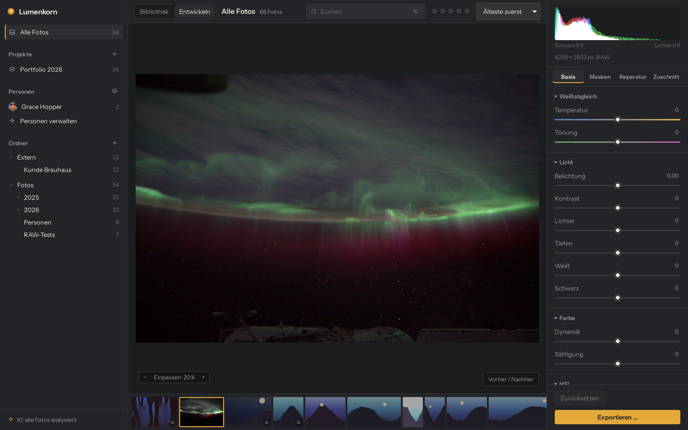
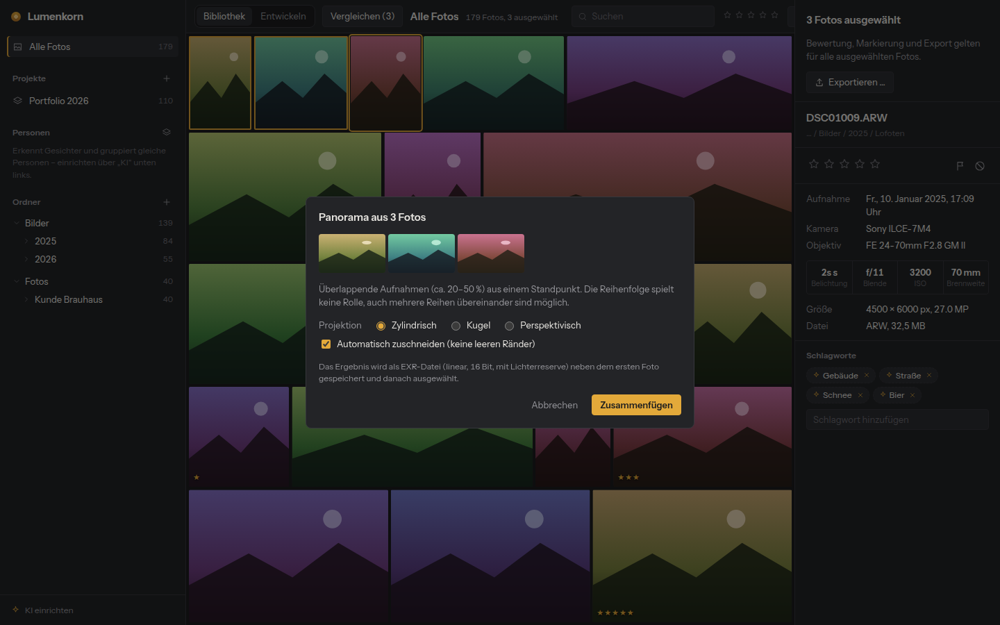

<div align="center">


# Lumenkorn

**Photo library and RAW developer that runs entirely on your own computer.**

[](https://github.com/DrayPrescot/lumenkorn/actions/workflows/ci.yml)
[](#license)


[Features](#features) · [Getting started](#getting-started) · [How it works](#how-it-works) · [Tech stack](#tech-stack) · [Open-source credits](#open-source-projects-used-by-lumenkorn) · [Deutsch](docs/README.de.md)



</div>

Lumenkorn is meant as a replacement for Lightroom Classic for people who want to keep their
photos and their edits on their own disk. You point it at your photo folders, it builds a
catalog, and you rate, sort, develop and export from there. The originals are never touched.

There is no account, no cloud and no subscription. The AI features (keywords, search by image
content, masks, noise reduction, object removal, face recognition) use open models that are
downloaded once and then run offline on your CPU or GPU.

The project is young (version 0.1). It is mainly used on Windows and is also built and tested
on Linux. The interface is in German and English and follows
the system language; **DE / EN** at the bottom left of the sidebar switches it.

## Features

### Library
- Folders are read in place. Nothing is imported, copied or moved.
- A file watcher picks up new, changed, renamed and moved files. Moved files are recognized by
  a content hash, so ratings, keywords and edits stay with the photo.
- Projects collect any number of folders, also across drives.
- Ratings (`0`–`5`), pick and reject flags (`P` / `X`), keywords, and a search over file name,
  folder, camera, lens, keywords and people.
- Culling: `Shift+X` rejects and moves on. Rejected photos can be sent to the system trash in
  one step, together with their sidecar files and Lumenkorn's own data for them.
- Compare up to 12 photos side by side with linked zoom, with a filmstrip below to swap photos
  in and out. Any photo can be viewed at 100 % from the full-resolution file.
- Supported formats: JPEG, PNG, TIFF (8, 16 and 32 bit), WebP, OpenEXR and RAW files from Canon,
  Nikon, Sony, Fujifilm, Panasonic, Olympus/OM System, Pentax, DNG and others supported by rawler.

### Develop (non-destructive)
- White balance, exposure, contrast, highlights, shadows, whites, blacks, clarity, dehaze,
  vibrance, saturation and sharpening.
- HSL for eight color ranges, with an eyedropper that adjusts the color you click on.
- Color grading with wheels for shadows, midtones, highlights and the whole image, plus
  blending and balance, as in Lightroom.
- Lens correction for RAW files (on by default): distortion, color fringes and vignetting,
  from the correction data the camera writes into the file (Sony ARW, DNG) or from a
  [Lensfun](https://lensfun.github.io/) profile for about 1,500 lenses.
- Crop, rotate, flip, and straighten with automatic horizon detection.
- Local adjustments: linear and radial gradients, brush, color range, and AI masks for
  subject, sky and any object you click on. Shapes can be added to or subtracted from each
  other ("sky minus church tower").
- AI noise reduction and AI repair (remove dust, power lines, people, signs).
- History with undo/redo, snapshots, copy and paste of settings to many photos, and a
  "reset to original" button that asks before discarding everything.
- Export to JPEG, 16-bit TIFF or PNG, by default into an `Export` folder next to each original.

### Merge


Select photos, right-click and choose **Zusammenfügen** (merge):

- **HDR** from exposure brackets (`Ctrl+H`), handheld, up to ±6 EV, with optional deghosting.
- **Panorama** (`Ctrl+M`) in any shot order and with several rows; cylindrical, spherical or
  perspective projection.
- **Focus stacking** (`Ctrl+Shift+F`), which also corrects focus breathing.

The result is a linear 16-bit OpenEXR file next to the source photos. It goes into the catalog
right away and is developed like a RAW file, so highlights above 1.0 can still be recovered.

<br clear="right">

### People
Faces are found in the background, grouped by similarity, and suggested for a name once you
have named a few. Suggestions can be confirmed or rejected one by one or many at once. Named
people can be sorted into your own collapsible groups, such as family and friends; the rest are
listed under *Sonstige*, and faces not named yet under *Unbenannt*, so the overview stays short.

## Getting started

### Download
The current state of `main` is always available as a Windows installer (German and English
MSI) under the [nightly](https://github.com/DrayPrescot/lumenkorn/releases/tag/nightly)
pre-release. It is rebuilt after every push that passes CI, and a new version installs over
the old one. Tagged versions on the [Releases](https://github.com/DrayPrescot/lumenkorn/releases)
page also include Linux packages (`.deb`, `.rpm`, `.AppImage`).

The installers are not code-signed yet. Windows SmartScreen will ask once
("More info" → "Run anyway").

### First steps
1. Click **+** next to *Ordner* and choose a folder with photos.
2. Rate with `0`–`5`, flag with `P` / `X`, and press `D` to develop the selected photo.
3. Optional: **KI** at the bottom left downloads the AI models. Everything else works without them.

### Keyboard shortcuts

| Key | Action |
|---|---|
| Arrow keys | Move between photos |
| `Enter` / `E` | Show large (several selected: compare) |
| `D` / `G` or `Esc` | Develop / back to the grid |
| `0`–`5` | Rating |
| `P` / `X` / `U` | Pick / reject / clear flag |
| `Shift+X` | Reject and go to the next photo |
| `Ctrl+Del` | Delete rejected photos (asks first) |
| `C` | Compare selected photos |
| `Z`, mouse wheel | Zoom (fit ↔ 100 %) |
| `\` | Before / after |
| `R` | Crop |
| `[` / `]` | Rotate left / right |
| `O` | Show the selected mask in red |
| `Ctrl+Z` / `Ctrl+Shift+Z` | Undo / redo |
| `Ctrl+Shift+C` / `Ctrl+Shift+V` | Copy / paste settings |
| `Ctrl+Shift+E` | Export selection |
| `Ctrl+H` / `Ctrl+M` / `Ctrl+Shift+F` | HDR / panorama / focus stack |
| `F11` | Fullscreen |

The [German documentation](docs/README.de.md) describes every feature in more detail.

## How it works

Lumenkorn is a desktop app made of two halves. The window shows a web interface written in
Svelte. Everything that touches files, pixels or models happens in Rust. The two talk through
Tauri: the interface calls Rust commands and gets JSON back, and images are fetched through a
custom `lw://` URL scheme, so pixel data never goes through JSON and the webview can cache it.

```
 Svelte UI (src/)                      Tauri shell (src-tauri/)
 ┌──────────────────────┐   commands   ┌───────────────────────────────────────────┐
 │ grid, develop, masks │ ───────────▶ │ commands, background worker, lw:// images │
 │ people, compare, ... │ ◀─────────── │ progress events, crash guard, log file    │
 └──────────────────────┘ JSON, events └────┬──────────────┬──────────────┬────────┘
                                            │              │              │
                                  lumenkorn-core   lumenkorn-develop   lumenkorn-ai
                                  catalog, scan,   RAW decoding,       ONNX Runtime,
                                  thumbnails,      pipeline (CPU+GPU), models, masks,
                                  people           masks, merge, export denoise, faces
```

The three crates do not know about Tauri. They can be used and tested without a window.

### Catalog and folders
The catalog is a single SQLite database in the app data folder. It stores source folders,
photos, projects, keywords, faces and edits. A scan walks the folders, reads EXIF data and
hashes each file with BLAKE3. When a file disappears and a file with the same hash shows up
elsewhere, it is treated as moved and keeps its data. After the first scan a file watcher
reports changes; Lumenkorn collects them for 1.5 seconds and only looks at the reported
paths, which matters on network drives with tens of thousands of files.

Search uses an SQLite FTS5 index with trigrams, so partial words match ("sonnen" finds
"Sonnenuntergang") and accents do not matter.

Thumbnails (512 px) and previews (2048 px) are JPEGs in the system cache folder. For unedited
RAW files Lumenkorn uses the JPEG the camera embedded, which is much faster than developing.
Once a photo is edited, its thumbnail is rendered by the develop pipeline.

### The develop pipeline
An edit is a small JSON document with all slider values, masks and geometry. Nothing else is
saved, so edits take no extra disk space and can always be changed or undone.

To show a photo, Lumenkorn decodes it once into a linear floating-point image:

1. RAW files are read with [rawler](https://github.com/dnglab/dnglab). Lumenkorn then
   demosaics them itself: RCD for Bayer sensors and Markesteijn for Fujifilm X-Trans.
   It also applies capture sharpening at sensor resolution, adapted to the measured noise,
   because every RAW is slightly soft out of the camera.
2. JPEG, PNG, TIFF and WebP are converted to linear light. Very large images (panoramas,
   astro stacks) are averaged down while converting instead of being expanded to a full-size
   float copy first.

For the live preview this image is scaled to 2048 px and kept in memory. Every slider change
runs the pipeline on that proxy, which takes a few milliseconds on a GPU. When you zoom in,
only the visible part is rendered again from full resolution. Export renders the whole photo
at full resolution.

The pipeline runs in a fixed order:

| Step | Works on |
|---|---|
| Lens correction (RAW only) | linear, before everything else |
| White balance, exposure | linear scene light |
| Base tone curve (RAW only) | scene light → display |
| Dehaze | display-referred values |
| Whites/blacks, highlights/shadows, contrast, clarity | brightness |
| Vibrance, saturation, HSL, color grading | color (HSL in Oklch) |
| Local adjustments (masks) | each layer blended in |
| Sharpening | brightness |
| Rotate, flip, straighten, crop | last |

Highlights, shadows and clarity work with blurred brightness maps whose radius is relative to
the image size, so the 2048-px preview looks like the 6000-px export. Dehaze estimates the haze
with a dark-channel method, but with a neutral haze color, so colors do not drift blue or
yellow. With default settings the pipeline leaves a JPEG unchanged.

### GPU
The same pipeline exists twice: in Rust for the CPU (parallel with Rayon) and as WGSL compute
shaders for the GPU through [wgpu](https://wgpu.rs). wgpu talks to the graphics driver
directly, through DirectX 12 or Vulkan on Windows and Vulkan on Linux, so nothing extra has
to be installed. A test renders every slider, mask type and geometry case on both and compares
the pixels; the largest allowed difference is far below one 8-bit step. If there is no
suitable GPU or the driver fails, Lumenkorn uses the CPU path.

### Masks
A mask layer has its own set of sliders and consists of one or more shapes. Gradients, brush
strokes and color ranges are stored as parameters. AI masks are stored as grayscale PNG files in
the data folder. Masks refer to the upright original image, so rotating or cropping later does
not move them off the subject. The shape of each mask is computed on the CPU and cached, because
it does not change while you drag a slider.

### AI features
The AI part uses [ONNX Runtime](https://onnxruntime.ai) through the
[ort](https://github.com/pykeio/ort) crate. ONNX Runtime is not built into the app. It is loaded
at run time, so Lumenkorn starts and works without it, and the right build can be downloaded per
platform. For the GPU, Lumenkorn downloads the official WebGPU build of ONNX Runtime, which runs
on AMD, NVIDIA and Intel cards through DirectX 12, Vulkan or Metal, without CUDA or ROCm.
GPU sessions take turns, because the WebGPU backend does not allow two models to compute at
the same time.

| Feature | Model | What Lumenkorn does with it |
|---|---|---|
| Keywords, search by content | CLIP ViT-B/32 | Compares each photo with a vocabulary of German and English terms in five groups (place, subject, light, weather, style). Search turns your text into the same kind of vector. |
| Subject mask | IS-Net (DIS) | Predicts the main subject. |
| Object mask | Segment Anything ViT-B | Turns your clicks into a mask; the image embedding is computed once per photo. |
| Sky mask | skyseg (U²-Net) | Predicts the sky. Uncertain edges, such as tree tops, are then decided by comparing each pixel with the colors of nearby sure sky and sure foreground. Without the model a color-based rule set is used. |
| Noise reduction | DRUNet | Lumenkorn downloads the original PyTorch weights and converts them to ONNX on your machine. The noise level is estimated per brightness and on two scales; color noise gets an extra pass at half resolution. |
| Object removal | LaMa | Each area is cut out with some surroundings, filled and blended back at full resolution. |
| Faces | YuNet, SFace | YuNet finds faces (also small ones in group photos, by searching in tiles), SFace turns each aligned face into a vector. Similar vectors form a group. |

Results that are expensive to compute (denoised image, repair patches, AI masks) are stored in
the data folder and used by the pipeline like any other input. Models are unloaded after a
few minutes without use.

### Merge
All three merge modes share an alignment step: Harris corners on a brightness-normalized
image, BRIEF descriptors, matching by Hamming distance, and a homography estimated with
RANSAC.

- **HDR** takes the middle exposure as reference, measures the real exposure ratios from the
  pixels, and merges to linear radiance with weights that favor well-exposed and less noisy
  values. Deghosting falls back to the reference where something moved.
- **Panorama** builds a graph of all overlapping pairs, estimates the focal length and the
  rotation of each shot, levels the horizon, projects, equalizes brightness and blends.
- **Focus stacking** splits each frame into a Laplacian pyramid and keeps, per level and pixel,
  the sharpest detail.

### Your data
- Catalog, edits, AI models and AI results live in the app data folder:
  - Windows: `%APPDATA%\io.github.drayprescot.lumenkorn\`
  - Linux: `~/.local/share/io.github.drayprescot.lumenkorn/`
- Thumbnails are in the system cache folder.
- Lumenkorn writes to your photo folders only when you ask it to: deleting rejected photos,
  saving merge results, or exporting.
- The only network access is downloading the AI runtime and models when you click the
  button for it. Files with a published checksum are verified with SHA-256.
- A log file (`lumenkorn.log`) in the data folder records errors and what the AI did.
  Before risky native steps (loading a GPU runtime, opening a model) Lumenkorn leaves a marker
  file. If the app crashes there, the next start switches the cause off and explains why.

## Tech stack

| Area | Used |
|---|---|
| Language (backend) | Rust 1.95, edition 2024 |
| App shell | Tauri 2 (WebView2 on Windows, WebKitGTK on Linux) |
| Interface | Svelte 5 with runes, TypeScript, Vite |
| Database | SQLite (bundled through rusqlite), FTS5 full-text search |
| RAW decoding | rawler (from dnglab) |
| Image files | image-rs, jpeg-encoder, exrs, kamadak-exif |
| GPU image processing | wgpu with WGSL compute shaders |
| CPU parallelism | Rayon |
| AI inference | ONNX Runtime via ort, CPU or WebGPU |
| Downloads | ureq with the operating system's certificate store |
| CI | GitHub Actions, Mesa lavapipe for GPU tests without a GPU, Dependabot |
| Installers | Tauri bundler: MSI and NSIS on Windows, deb, rpm and AppImage on Linux |

## Building from source

**Requirements**
- Rust 1.95 (pinned in `rust-toolchain.toml`; rustup installs it automatically).
- Node.js 20 or newer.
- The [Tauri prerequisites](https://v2.tauri.app/start/prerequisites/) for your platform:
  - **Windows:** Microsoft C++ Build Tools and WebView2 (usually preinstalled on Windows 10 and 11).
  - **Debian/Ubuntu:**
    ```bash
    sudo apt install libwebkit2gtk-4.1-dev build-essential libxdo-dev libssl-dev \
      libayatana-appindicator3-dev librsvg2-dev
    ```

**Commands**
```bash
npm install
npm run tauri dev          # run the app with hot reload
npm run tauri build        # build installers
npm run dev                # interface only, in the browser, with demo data

cargo test --workspace     # all tests
cargo run --release -p lumenkorn-develop --example bench    # CPU vs. GPU benchmark
```

GPU tests on machines without a GPU need Mesa's software Vulkan driver (lavapipe) and
`LUMENKORN_GPU_SOFTWARE=1`. Some tests use real model files or photos and only run when the
matching `LUMENKORN_TEST_*` variables are set; the
[German documentation](docs/README.de.md#entwickeln-am-code) lists them.

### Repository layout
```
lumenkorn/
├── crates/lumenkorn-core/      catalog, folder scanner, file watcher, thumbnails, people
├── crates/lumenkorn-develop/   RAW decoding, demosaicing, pipeline (CPU + gpu/ shaders),
│                               masks, repair patches, merge/, export
├── crates/lumenkorn-ai/        ONNX Runtime loading, CLIP, segmentation, DRUNet, LaMa,
│                               faces, model downloads, a small ONNX writer
├── src-tauri/                  Tauri commands, background worker, lw:// protocol, crash guard
├── src/                        Svelte interface, translations in src/lib/i18n/
├── scripts/, tools/            translation check, test model generator
└── docs/                       German documentation, screenshots
```

## Contributing
Issues and pull requests are welcome. Please run these before submitting:
```bash
cargo fmt --all
cargo clippy --workspace --all-targets -- -D warnings
cargo test --workspace
npm run check
npm run i18n               # every UI text has an English translation
```

Interface texts are written in German in the source and double as their keys:
`t("Ordner hinzufügen")` shows "Add folder" in English. The English texts are in
`src/lib/i18n/en/*.ts`. Backend messages use `tr!("deutsch", "english")`.

Dependabot checks Rust crates, npm packages and GitHub Actions every Monday. Small updates are
merged automatically after CI passes; breaking ones are labeled `manual-review`. CI also tests
every rawler update against real RAW files from several cameras. The Rust toolchain, the AI
models and ONNX Runtime are pinned on purpose and updated by hand.

A version tag such as `v0.2.0` builds the Windows and Linux installers and creates a draft
release.

## Open-source projects used by Lumenkorn

Lumenkorn would not exist without the following projects. Thank you to everyone who works on them.

### Libraries built into the app

| Project | Used for | License |
|---|---|---|
| [Tauri](https://github.com/tauri-apps/tauri) and [tauri-plugin-dialog](https://github.com/tauri-apps/plugins-workspace) | app shell, window, file dialogs | MIT or Apache-2.0 |
| [Svelte](https://github.com/sveltejs/svelte) | user interface | MIT |
| [rawler](https://github.com/dnglab/dnglab) (dnglab) | reading RAW files | LGPL-2.1 |
| [wgpu](https://github.com/gfx-rs/wgpu) | GPU image processing | MIT or Apache-2.0 |
| [ort](https://github.com/pykeio/ort) | Rust bindings for ONNX Runtime | MIT or Apache-2.0 |
| [ONNX Runtime](https://github.com/microsoft/onnxruntime) | running the AI models (downloaded on demand) | MIT |
| [SQLite](https://sqlite.org) via [rusqlite](https://github.com/rusqlite/rusqlite) | catalog and search index | public domain / MIT |
| [image](https://github.com/image-rs/image) | reading and writing JPEG, PNG, TIFF, WebP | MIT or Apache-2.0 |
| [jpeg-encoder](https://github.com/vstroebel/jpeg-encoder) | fast JPEG encoding | MIT or Apache-2.0, IJG |
| [exrs](https://github.com/johannesvollmer/exrs) | OpenEXR files for merge results | BSD-3-Clause |
| [kamadak-exif](https://github.com/kamadak/exif-rs) | EXIF metadata | BSD-2-Clause |
| [Rayon](https://github.com/rayon-rs/rayon) | parallel CPU processing | MIT or Apache-2.0 |
| [notify](https://github.com/notify-rs/notify) | file watching | CC0-1.0 |
| [walkdir](https://github.com/BurntSushi/walkdir) | folder scanning | MIT or Unlicense |
| [BLAKE3](https://github.com/BLAKE3-team/BLAKE3) | content hashes for moved files | CC0-1.0 or Apache-2.0 |
| [trash](https://github.com/Byron/trash-rs) | moving files to the system trash | MIT |
| [ureq](https://github.com/algesten/ureq) | model downloads | MIT or Apache-2.0 |
| [serde](https://github.com/serde-rs/serde), [serde_json](https://github.com/serde-rs/json) | settings, edits, IPC | MIT or Apache-2.0 |
| [RustCrypto sha2](https://github.com/RustCrypto/hashes) | download checksums | MIT or Apache-2.0 |
| [flate2](https://github.com/rust-lang/flate2-rs), [tar](https://github.com/composefs/tar-rs), [zip](https://github.com/zip-rs/zip2) | unpacking runtime downloads | MIT or Apache-2.0 / MIT |
| [half](https://github.com/VoidStarKat/half-rs), [bytemuck](https://github.com/Lokathor/bytemuck), [pollster](https://github.com/zesterer/pollster) | 16-bit floats, GPU buffers | MIT or Apache-2.0 |
| [regex](https://github.com/rust-lang/regex), [log](https://github.com/rust-lang/log), [env_logger](https://github.com/rust-cli/env_logger), [thiserror](https://github.com/dtolnay/thiserror), [libloading](https://github.com/nagisa/rust_libloading) | text processing, logging, errors, loading DLLs | MIT or Apache-2.0 / ISC |
| [Lensfun](https://github.com/lensfun/lensfun) database (bundled, converted to JSON by `tools/lensfun_db.py`) | lens profiles for lens correction | CC BY-SA 3.0 |
| [Instrument Sans](https://github.com/Instrument/instrument-sans) via [Fontsource](https://fontsource.org) | interface font | OFL-1.1 |

### AI models (downloaded on demand, not shipped with the app)

| Model | Authors | Downloaded from | License |
|---|---|---|---|
| CLIP ViT-B/32 | OpenAI; ONNX conversion by [Xenova](https://huggingface.co/Xenova/clip-vit-base-patch32) | Hugging Face | MIT |
| IS-Net / DIS | [Xuebin Qin et al.](https://github.com/xuebinqin/DIS) | [rembg](https://github.com/danielgatis/rembg) releases | Apache-2.0 |
| Segment Anything (ViT-B, quantized) | [Meta AI](https://github.com/facebookresearch/segment-anything) | rembg releases | Apache-2.0 |
| skyseg (U²-Net) | [xiongzhu666](https://github.com/xiongzhu666/Sky-Segmentation-and-Post-processing), based on [U²-Net](https://github.com/xuebinqin/U-2-Net) | [Hugging Face](https://huggingface.co/JianyuanWang/skyseg) | MIT |
| DRUNet | Kai Zhang et al., [KAIR](https://github.com/cszn/KAIR) | KAIR releases | MIT |
| LaMa | [Samsung AI](https://github.com/advimman/lama) | [OpenCV Model Zoo](https://github.com/opencv/opencv_zoo) | Apache-2.0 |
| YuNet | Shiqi Yu et al. | OpenCV Model Zoo | MIT |
| SFace | Yaoyao Zhong et al. | OpenCV Model Zoo | Apache-2.0 |

Face recognition deliberately does not use the common InsightFace models, because their
license only allows non-commercial use.

### Published methods implemented in Lumenkorn
- RCD demosaicing (Luis Sanz Rodríguez), as used in RawTherapee and darktable.
- Markesteijn demosaicing for X-Trans (Frank Markesteijn).
- Oklab and Oklch color spaces (Björn Ottosson) for HSL, color ranges and color grading.
- Dark channel prior (Kaiming He et al.) as the basis of dehaze.
- Lens models: Lensfun/Hugin distortion (poly3, poly5, ptlens), TCA and vignetting (pa) models,
  the DNG opcodes WarpRectilinear and FixVignetteRadial (Adobe DNG specification), and the
  meaning of Sony's embedded correction tags as worked out by
  [darktable](https://github.com/darktable-org/darktable) and
  [RawTherapee](https://github.com/Beep6581/RawTherapee). Lumenkorn implements all of them
  itself; no code from these projects is included.
- Harris corners, BRIEF descriptors, RANSAC and Hartley normalization for alignment.
- Laplacian pyramids (Burt and Adelson) for focus stacking.

### Development and testing
[TypeScript](https://github.com/microsoft/TypeScript), [Vite](https://github.com/vitejs/vite),
[svelte-check](https://github.com/sveltejs/language-tools), the
[Tauri CLI](https://github.com/tauri-apps/tauri), [Mesa](https://www.mesa3d.org) (lavapipe for
GPU tests in CI), [tempfile](https://github.com/Stebalien/tempfile), and the RAW samples from
[OpenImageIO-images](https://github.com/AcademySoftwareFoundation/OpenImageIO-images) that CI uses
to test rawler updates.

## Roadmap
- XMP sidecars, hierarchical keywords, and a multilingual text model for search.
- Presets, luminance range masks, and copying masks between photos.
- Further GPU tuning based on measurements on real hardware.

The [changelog](CHANGELOG.md) lists what is already included.

## License

Lumenkorn is dual-licensed under either of

- [MIT license](LICENSE-MIT)
- [Apache License, Version 2.0](LICENSE-APACHE)

at your option. Unless you explicitly state otherwise, any contribution you submit for
inclusion in this project is dual-licensed in the same way, without any additional terms.

rawler is licensed under the LGPL-2.1, and release builds link it statically. To use a modified
rawler, change the `rawler` dependency in `crates/lumenkorn-develop/Cargo.toml` and build from
source as described above. The AI models are not part of Lumenkorn; each keeps the license
listed above. The bundled Lensfun database (`crates/lumenkorn-develop/data/lensfun.json.gz`)
is licensed under CC BY-SA 3.0 (`crates/lumenkorn-develop/data/LICENSE-lensfun-db.txt`).
